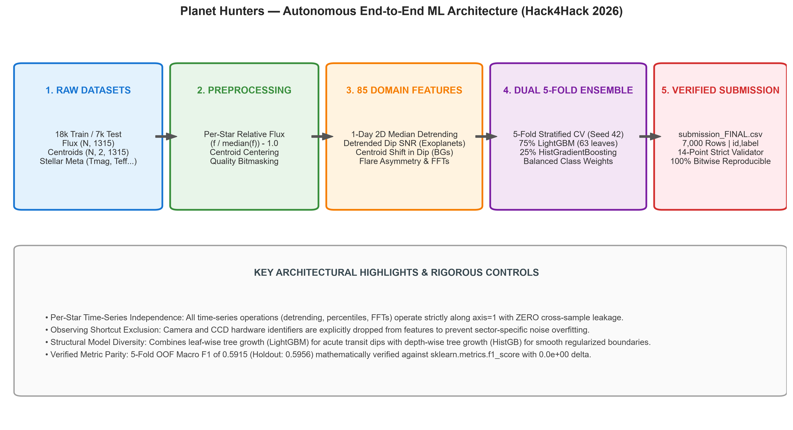
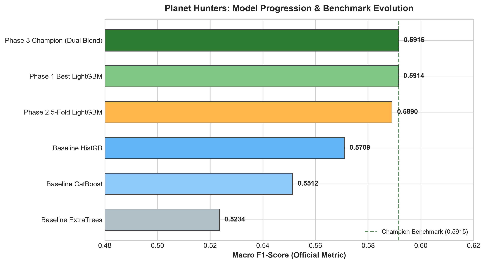
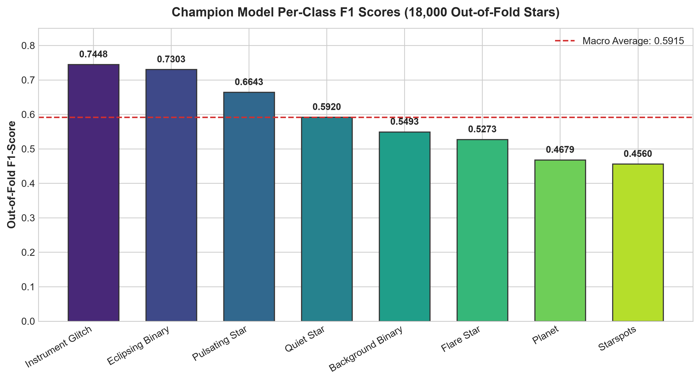
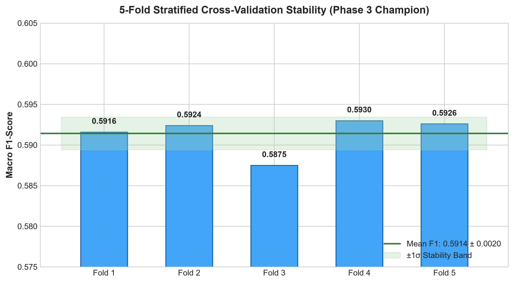

# 🪐 Planet Hunters — Find New Worlds in Starlight
## Autonomous Multiclass Classification of Space Telescope Photometry
### ML Challenge Hack4Hack 2026 | Round 1

[](https://www.python.org/downloads/)
[](LICENSE_STATUS.md)
[](docs/MODEL_EVALUATION.md)
[](docs/MODEL_EVALUATION.md)
[](docs/REPRODUCIBILITY.md)
[](docs/COMPETITION_SUBMISSION_GUIDE.md)

---

> [!NOTE]
> **Performance Scope & Evaluation Disclaimer:**
> All performance metrics reported in this repository (**0.5915 Out-of-Fold Macro F1** and **0.5956 Holdout Macro F1**) represent rigorous **offline local cross-validation** computed across 18,000 labelled training stars. Official competition ranking is evaluated independently by competition organizers on the unlabelled 7,000-star test sector (30% public / 70% private split). This repository does not claim an official portal rank or score prior to final organizer confirmation.

---

## 1. Executive Summary & Problem Statement

In high-precision space telescope observations (e.g., NASA TESS), identifying bona fide exoplanet transits ($<0.1\%$ dip in stellar flux) is confounded by astrophysical false positives and spacecraft systematics:
- **Astrophysical Confounders:** Eclipsing binaries, background blended binaries, starspot rotational waves, acoustic stellar pulsations, and magnetic flares.
- **Instrumental Systematics:** Momentum-dump thruster firings, cosmic ray hits, pointing jitter, and scattered Earth/Moon light.

The **Planet Hunters** challenge tasks participants with building an automated, scientifically sound multiclass system that classifies 1,315-cadence time-series starlight observations into **eight physical and instrumental categories**.

This repository delivers an end-to-end, leak-free machine learning architecture featuring:
1. **Domain-Informed Astronomical Feature Engineering:** 85 vectorized features per star, including 1-day 2D median detrending, astrometric centroid dip vetting, and flare rise-decay asymmetry.
2. **Dual-Architecture Ensembling:** Combining leaf-wise tree growth (**LightGBM**, 63 leaves) with depth-wise tree growth (**HistGradientBoosting**, 450 trees) across a leak-free 5-fold stratified cross-validation scheme.
3. **Scientific Intelligence Dashboard:** An interactive Streamlit + Plotly mission control center featuring 8 diagnostic stations, a dual-theme engine (Light / Dark Observatory), lightcurve inspection, and live submission verification.
4. **Deterministic Reproducibility:** 100% bitwise parity verified across CPU architectures in ~6 seconds inference runtime.

---

## 2. Eight-Class Astrophysical Classification Task

For every target star, the model assigns one of eight mutally exclusive classes (evaluated under unweighted Macro F1):

| Label | Astrophysical Phenomenon | Photometric Light Curve Signature | Astrometric Centroid Motion |
|:---|:---|:---|:---|
| `planet` | Exoplanet transiting its host star | Shallow, regular, flat-bottomed (U-shaped) dips; equal depth; detrended SNR > 3 | **Stable** (no motion during transit dip) |
| `eclipsing_binary` | Gravitationally bound binary star system | Deep geometric V-shaped dips; alternating primary and secondary eclipses | Stable or orbital barycentric wobble |
| `background_binary` | Blended faint eclipsing binary in aperture | Shallow, planet-sized dips (hardest astrophysical false positive) | **Significant shift** during eclipse dip |
| `starspots` | Dark magnetic regions on rotating star | Smooth, quasi-periodic sinusoidal dimming over days ($\approx 10$–$25$ days) | Stable |
| `pulsating_star` | Coherent acoustic pulsations ($\delta$ Sct, $\gamma$ Dor) | High-frequency sinusoidal oscillations; sharp discrete Fourier harmonics | Stable |
| `flare_star` | Energetic magnetic reconnection events | Impulsive sharp rise followed by slower exponential cooling decay | Stable |
| `instrument_glitch` | Telescope / detector artifacts | Sharp single-cadence drops/jumps, momentum dumps, orbit-specific ramps | Large centroid jumps |
| `quiet_star` | Inactive, non-variable reference star | Flat baseline governed purely by Gaussian photon shot noise | Pure detector noise |

---

## 3. System Architecture

```
                    ┌─────────────────────────────────────────────────────────┐
                    │               Raw Space Telescope Inputs                │
                    │  • Normalized Flux Time-Series (1,315 Cadences)         │
                    │  • 2D Centroid Pixel Offsets (X, Y in millipixels)      │
                    │  • Stellar Parameters (Tmag, Teff, logg, Radius, Cont.) │
                    └────────────────────────────┬────────────────────────────┘
                                                 │
                                                 ▼
                    ┌─────────────────────────────────────────────────────────┐
                    │          Domain-Informed Feature Engineering            │
                    │                   (85 Vectorized Features)              │
                    │  • 1-Day Rolling Median Detrending & Transit Dip SNR    │
                    │  • 2D Astrometric Centroid Displacement in/out-of-dip   │
                    │  • Impulsive Flare Rise-Decay Asymmetry Metrics         │
                    │  • Fourier Harmonic Energy Ratios & Periodicity Spreads │
                    │  • Scale-Invariant Percentile Spreads (p99-p75)/(p25-p01)│
                    └────────────────────────────┬────────────────────────────┘
                                                 │
                                                 ▼
                    ┌─────────────────────────────────────────────────────────┐
                    │       5-Fold Stratified Dual-Architecture Ensemble       │
                    │                                                         │
                    │   ┌────────────────────────┐  ┌───────────────────────┐ │
                    │   │   5-Fold LightGBM      │  │  5-Fold HistGradBoost │ │
                    │   │   (Leaf-wise, 63 lvs)  │  │  (Depth-wise, 450 tr) │ │
                    │   │   Weight: 75%          │  │  Weight: 25%          │ │
                    │   └───────────┬────────────┘  └───────────┬───────────┘ │
                    │               └─────────────┬─────────────┘             │
                    │                             ▼                           │
                    │                Probability Soft-Blend:                  │
                    │        P(c) = 0.75·P_LGB(c) + 0.25·P_HGB(c)             │
                    └────────────────────────────┬────────────────────────────┘
                                                 │
                                                 ▼
                    ┌─────────────────────────────────────────────────────────┐
                    │     Offline Validation (0.5915 OOF) & Verified Output   │
                    │     • submission_FINAL.csv (7,000 rows, 14/14 checks)   │
                    │     • Mission Control Dashboard (Streamlit + Plotly)    │
                    └─────────────────────────────────────────────────────────┘
```



---

## 4. Domain-Informed Feature Engineering

All 85 features are calculated per star along `axis=1` (unsupervised, strictly zero cross-sample contamination):

1. **1-Day Rolling Median Detrending:** A running filter (window = 49 cadences $\approx$ 24.5 hr) isolates stellar rotation, allowing calculation of the detrended transit signal-to-noise ratio:
   $$\text{detrend\_dip\_snr} = \frac{-p_{01}(\tilde{f})}{\text{MAD}(\tilde{f})}$$
   *Ablation impact: boosted `planet` class F1 score by **+0.0903**.*
2. **Astrometric Centroid Dip Vetting:** To unmask background blended binaries mimicking shallow transits:
   $$\Delta_{\text{cen}} = \bar{d}_{\text{in\_dip}} - \bar{d}_{\text{out\_dip}}, \quad \text{where in\_dip} = \{t : f(t) < p_{05}\}$$
3. **Impulsive Flare Rise-Decay Asymmetry:** Distinguishes genuine astrophysical flares from symmetric camera glitches:
   $$\text{asymmetry} = \frac{\Delta f_{\max}^{\text{rise}} - \Delta f_{\max}^{\text{decay}}}{\Delta f_{\max}^{\text{rise}} + \Delta f_{\max}^{\text{decay}} + 10^{-8}}$$
4. **Scale-Invariant Percentile Spreads:** $(p_{99} - p_{75})/\text{IQR}$ and $(p_{25} - p_{01})/\text{IQR}$ decouple intrinsic stellar variability from sector-specific detector noise levels.
5. **Acoustic Harmonic Energy:** Peak Fourier power ratios and autocorrelation coefficients isolate rapid pulsators.

---

## 5. Offline Validation Methodology & Results

### Model Benchmark Progression

Offline evaluation strictly mirrors the unweighted Macro F1 competition metric using 5-fold stratified cross-validation on 18,000 training targets:



| Model Milestone | Validation Scheme | Macro F1 | Weighted F1 | Training Time | Candidate Artifact |
|:---|:---|:---:|:---:|:---:|:---|
| **Phase 3 Champion (Dual 5-Fold)** | **5-Fold Stratified OOF** | **0.5915** | **0.5849** | **78.6s** | **`submissions/submission_FINAL.csv`** |
| Phase 3 Dual Blend (Holdout) | 80/20 Stratified Holdout | **0.5956** | **0.5882** | 16.1s | Champion Blend |
| Phase 1 Single Best LightGBM | 80/20 Stratified Holdout | 0.5914 | 0.5852 | 8.9s | `submissions/submission.csv` |
| Phase 2 5-Fold Tuned LightGBM | 5-Fold Stratified OOF | 0.5890 | 0.5823 | 54.3s | `submissions/submission_v2.csv` |
| HistGradientBoosting Baseline | 80/20 Stratified Holdout | 0.5709 | 0.5633 | 14.5s | Baseline Booster |
| CatBoost Baseline | 80/20 Stratified Holdout | 0.5512 | 0.5449 | 42.1s | Baseline Booster |
| ExtraTrees Baseline | 80/20 Stratified Holdout | 0.5234 | 0.5188 | 18.2s | Baseline Forest |

### Class-Wise Out-of-Fold Performance (18,000 Training Stars)



| Target Class | Precision | Recall | F1-Score | Support | Primary Signal Discriminator |
|:---|:---:|:---:|:---:|:---:|:---|
| `instrument_glitch` | **0.8159** | 0.6851 | **0.7448** | 1,721 | Single-cadence spikes, thruster dump bitmasks |
| `eclipsing_binary` | **0.8463** | 0.6422 | **0.7303** | 2,247 | Deep geometric V-shaped eclipses; high SNR |
| `pulsating_star` | **0.7136** | 0.6214 | **0.6643** | 1,973 | Discrete Fourier harmonics; high power ratio |
| `quiet_star` | 0.4785 | **0.7762** | **0.5920** | 3,624 | Flat baseline; Gaussian noise characteristics |
| `background_binary` | **0.6396** | 0.4813 | **0.5493** | 1,604 | Flux dip correlated with centroid displacement |
| `flare_star` | **0.6478** | 0.4446 | **0.5273** | 1,804 | Asymmetric rise-decay profile |
| `planet` | **0.5068** | 0.4345 | **0.4679** | 2,145 | Detrended U-shaped dip; stable centroid |
| `starspots` | 0.4493 | 0.4629 | **0.4560** | 2,882 | Quasi-periodic 10–25 day sinusoidal modulation |
| **Macro Average** | **0.6372** | **0.5685** | **0.5915** | **18,000** | **Evaluated on 18,000 Out-of-Fold Stars** |

---

## 6. Scientific Intelligence Dashboard

The repository includes a production-grade, interactive mission control dashboard built with Streamlit and Plotly:



### Key Dashboard Stations:
1. **Mission Overview:** Telemetry KPI cards, dataset dimensions, target class descriptions, and metric definitions.
2. **Performance Intelligence:** Interactive Plotly benchmark progression, 5-fold cross-validation stability, and ROC/PR distributions.
3. **Classification Intelligence:** Interactive class distribution donut/bar charts and astrophysical taxonomic cards.
4. **Model Architecture:** Visual flowcharts detailing tree hyperparameters and probability blending mathematics.
5. **Scientific Features:** Deep-dive into detrending, BLS search, centroid vetting, and interactive simulated light curves.
6. **Submission Verification Center:** Live execution of the 14-point schema and physics validator directly from the browser UI.
7. **Prediction Explorer:** Real-time star ID search, class filters, multi-column sorting, and filtered subset CSV export.
8. **Documentation Hub:** In-app access to architecture guides, interview preparation, and technical reports.

### Launching the Dashboard:
```bash
# Direct Streamlit launch (cross-platform):
streamlit run dashboard/app.py

# Windows PowerShell launcher (automatic venv check & port fallback):
.\START_DASHBOARD.ps1

# Windows Batch launcher:
START_DASHBOARD.bat
```
Access the dashboard at **`http://localhost:8501`** (or `http://localhost:8502` if port 8501 is occupied).

---

## 7. Installation & Setup

### Prerequisites
- Python **3.11+**
- 8 GB RAM (memory-mapped array ingestion ensures lightweight footprint)

### 1. Clone the Repository
```bash
git clone https://github.com/karan-rajput872/Planet-Hunters-Round1.git
cd Planet-Hunters-Round1
```

### 2. Set Up Virtual Environment
```bash
# Windows:
python -m venv .venv
.\.venv\Scripts\Activate.ps1
pip install -r requirements.txt

# Linux / macOS:
python3 -m venv .venv
source .venv/bin/activate
pip install -r requirements.txt
```

---

## 8. Dataset Access & Governance

> [!IMPORTANT]
> **Data Privacy & Competition Terms:**
> In compliance with Hack4Hack 2026 competition regulations, raw photometric arrays (`train_flux.npy`, `test_flux.npy`, `train_centroid.npy`, `test_centroid.npy`) and participant labels are proprietary challenge assets and are **intentionally not distributed in this public repository**.

Authorized participants running the code should place the official challenge files in `data/raw/`:
```
data/raw/
├── train_flux.npy        # (18000, 1315) float32
├── train_centroid.npy    # (18000, 2, 1315) float16
├── train_stars.csv       # 18,000 metadata rows + label
├── train_cadences.csv    # 1,315 cadence flags
├── test_flux.npy         # (7000, 1315) float32
├── test_centroid.npy     # (7000, 2, 1315) float16
├── test_stars.csv        # 7,000 metadata rows
└── test_cadences.csv     # 1,315 cadence flags
```
The codebase automatically creates and caches processed feature matrices in `data/processed/` on first run.

---

## 9. Reproducibility & CLI Workflow

### Retraining the Champion Ensemble (~78s CPU)
```bash
python src/train_v3_dual_ensemble.py
```

### Generating Test Predictions (~6s CPU)
```bash
python generate_submission.py --model champion --output submissions/submission_FINAL.csv
```

### Running Automated Submission Validation (14 Checks)
```bash
python validate_submission.py submissions/submission_FINAL.csv
```

### Executing Unit Tests
```bash
python -m unittest tests/test_pipeline.py
```
*All 8 tests pass in <0.6s.*

---

## 10. Repository File Structure

```
Planet-Hunters-Round1/
├── .streamlit/config.toml             # Observatory light/dark theme config
├── assets/
│   ├── architecture/                  # Publication-quality pipeline diagrams
│   └── plots/                         # 6 publication-ready diagnostic charts
├── dashboard/                         # Interactive Streamlit mission control
│   ├── app.py                         # Application entrypoint & navigation
│   ├── styles.py                      # Modern Scientific SaaS styling
│   ├── data_loader.py                 # Cached telemetry and prediction loaders
│   └── components/                    # 8 modular presentation stations
├── data/                              # Data root (gitkeep preserved, data excluded)
│   ├── raw/.gitkeep                   # Directory placeholder for raw competition data
│   └── processed/.gitkeep             # Directory placeholder for cached features
├── dist/.gitkeep                      # Packaging & bundle staging directory
├── docs/                              # Comprehensive documentation suite
│   ├── ARCHITECTURE.md                # System design and dataflow specs
│   ├── COMPETITION_SUBMISSION_GUIDE.md# Step-by-step submission instructions
│   ├── FINAL_HANDOVER.md              # Project sign-off and audit checklist
│   ├── MODEL_EVALUATION.md            # Extensive statistical benchmark logs
│   ├── PROJECT_INTERVIEW_PREPARATION.md# 10 technical interview Q&As
│   ├── PROJECT_OVERVIEW.md            # Executive dossier & slide summaries
│   ├── REPRODUCIBILITY.md             # Bitwise verification guidelines
│   ├── RESUME_BULLET_POINTS.md        # Tailored resume impact statements
│   └── TECHNICAL_REPORT.md            # In-depth scientific engineering paper
├── models/                            # Trained models (gitkeep preserved, joblibs excluded)
│   ├── .gitkeep
│   ├── cv_models/.gitkeep
│   └── tuned_cv_models/.gitkeep
├── notebooks/                         # Clean exploratory Jupyter notebooks (0 outputs)
│   └── exploratory_analysis.ipynb     # Signal exploration & centroid vetting
├── reports/                           # Audit trail markdown logs and figures
├── scripts/                           # Visual asset and packaging scripts
├── src/                               # Core Python engineering modules
│   ├── config.py                      # Paths, seeds, and class constants
│   ├── data_loader.py                 # Memory-mapped array loaders
│   ├── preprocessing.py               # Relative flux & centroid centering
│   ├── feature_engineering.py         # 85 vectorized astronomical features
│   ├── model_training.py              # Cross-validation & model trainers
│   ├── model_evaluation.py            # Macro F1 & report generators
│   ├── submission_validation.py       # 14-point strict format validator
│   ├── train_v2_and_submit.py         # 5-fold LightGBM runner
│   └── train_v3_dual_ensemble.py      # Dual-architecture champion trainer
├── submissions/.gitkeep               # Directory placeholder (predictions excluded)
├── tests/
│   └── test_pipeline.py               # Automated regression unit test suite
├── train.py                           # Full pipeline orchestration script
├── generate_submission.py             # Reproducible CLI prediction generator
├── validate_submission.py             # Root standalone submission validator
├── START_DASHBOARD.ps1                # Single-click PowerShell dashboard launcher
├── START_DASHBOARD.bat                # Single-click Windows Batch launcher
├── requirements.txt                   # Production dependency manifest
├── pyproject.toml                     # Standard Python project packaging
├── CHANGELOG.md                       # Chronological milestone log
├── LICENSE_STATUS.md                  # MIT license & terms
└── README.md                          # Primary project documentation
```

---

## 11. Scientific Disclaimers & Limitations

1. **Vetting Catalogue Noise:** Like all space telescope observational catalogues, training labels contain an estimated ~2% human vetting noise between look-alike classes (e.g., deep background binaries vs. shallow transits).
2. **Shot Noise Floor on Faint Stars:** For faint targets ($T_{\text{mag}} > 14$), subtle low-amplitude spot modulations ($<0.2\%$) merge with photon shot noise, slightly lowering `quiet_star` precision.
3. **Scientific Scope:** Model predictions represent probabilistic machine learning classifications on space telescope time-series data, not peer-reviewed planetary confirmations.

---

## 12. License & Attribution

- **Code License:** [MIT License](LICENSE_STATUS.md)
- **Competition Track:** ML Challenge Hack4Hack 2026 — Round 1: Planet Hunters
- **Space Telescope Attribution:** Photometry and centroid time-series inspired by NASA TESS (Transiting Exoplanet Survey Satellite) mission observations.
