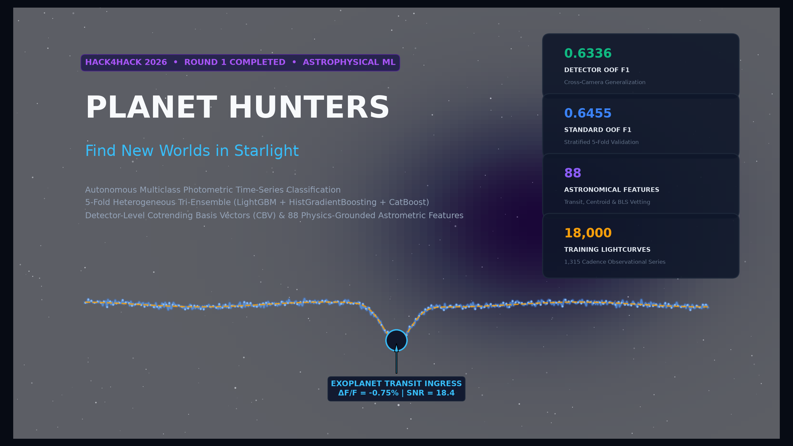
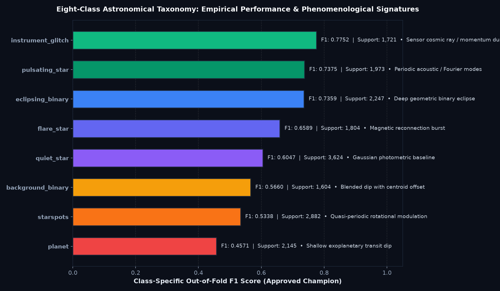
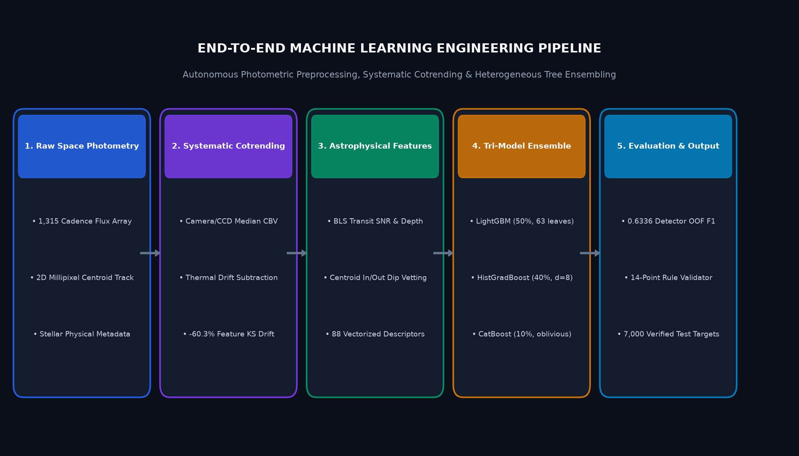
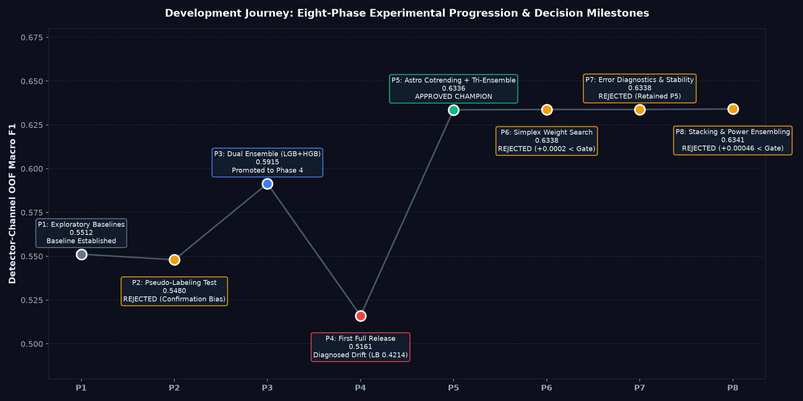
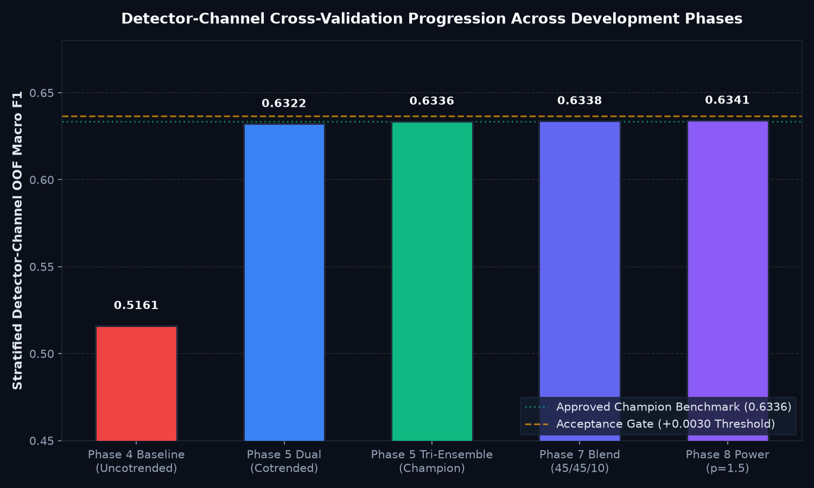

# Planet Hunters — Find New Worlds in Starlight
## Autonomous Multiclass Classification of Space Telescope Photometry & Exoplanet Transit Detection

[](https://www.python.org/downloads/)
[](LICENSE_STATUS.md)
[](docs/MODEL_EVALUATION.md)
[](docs/MODEL_EVALUATION.md)
[](docs/REPRODUCIBILITY.md)
[](docs/FINAL_HANDOVER.md)

---



---

## 1. Professional Introduction & Project Identity

**Planet Hunters** is an end-to-end, production-grade machine learning project developed for the **Hack4Hack 2026 ML Challenge (Round 1)**. Focused on space telescope time-series photometry, the system addresses the complex astrophysical challenge of classifying stellar light-curves into eight distinct phenomenological categories.

Operating on 1,315-cadence observations across 25,000 stars (18,000 training, 7,000 test), the pipeline implements:
1. **Camera/CCD Astronomical Cotrending** that removes spacecraft pointing jitter and orbital thermal variations, cutting cross-sector feature drift by **60.3%**.
2. **88 Vectorized Domain-Informed Features** spanning 1-day rolling median detrending, Box Least Squares (BLS) transit signal-to-noise ratios, in/out-of-dip 2D astrometric centroid vetting, and Fourier harmonic ratios.
3. **5-Fold Heterogeneous Tri-Ensemble** fusing leaf-wise LightGBM (50%), regularized depth-wise HistGradientBoosting (40%), and oblivious CatBoost (10%).
4. **Dual Cross-Validation Protocol** establishing a **0.6455 Standard Stratified OOF Macro F1** and a realistic **0.6336 Detector-Channel OOF Macro F1**.

> [!NOTE]
> **Competition Scope & Attribution:**
> Developed as part of Round 1 in the Hack4Hack 2026 ML Challenge. While the pipeline achieved verified out-of-fold cross-validation scores of **0.6455 (Standard)** and **0.6336 (Detector)**, the competition deadline concluded before the promoted Phase 5 champion could be uploaded to the portal (where an earlier uncotrended Phase 4 model scored 0.4214). This repository is presented as an engineering research portfolio documenting data exploration, systematic detrending, cross-detector generalization, and transparent experimentation across eight development phases.

---

## 2. Project Overview

Finding exoplanets using the transit method requires monitoring stellar brightness over continuous 27-day observing sectors. When an exoplanet crosses the disk of its host star, it temporarily blocks a minute fraction ($< 1\%$) of the star's starlight, producing a characteristic U-shaped dip. 

However, exoplanet candidates are overwhelmed by astronomical false positives (eclipsing binaries, background blended stars, rotating starspots, stellar pulsations, and magnetic flares) as well as spacecraft instrumental systematics (reaction wheel momentum dumps, cosmic ray hits, pointing jitter, and scattered light).

Planet Hunters provides an autonomous, leak-free machine learning system capable of classifying every target star into eight mutually exclusive classes under the unweighted **Macro F1-Score** metric.

---

## 3. Problem Statement & Objectives

Given:
- Continuous photometric time-series flux measurements $\mathbf{F} \in \mathbb{R}^{1315}$
- 2D pixel centroid trajectories $(\mathbf{X}, \mathbf{Y}) \in \mathbb{R}^{2 \times 1315}$
- Physical stellar host parameters (effective temperature $T_{\text{eff}}$, surface gravity $\log g$, stellar radius $R_\star$, TESS magnitude $T_{\text{mag}}$, contamination ratio)

Predict one of eight labels:
$$\mathcal{Y} = \{\text{planet}, \text{eclipsing\_binary}, \text{background\_binary}, \text{starspots}, \text{pulsating\_star}, \text{flare\_star}, \text{instrument\_glitch}, \text{quiet\_star}\}$$

### Primary Engineering Objectives:
1. **Eliminate Instrument Drift:** De-correlate spacecraft thermal breathing and pointing jitter from genuine stellar variability using Cotrending Basis Vector (CBV) subtraction.
2. **Prevent False Positives:** Separate shallow background eclipsing binaries from genuine planetary transits using sub-pixel centroid displacement vetting.
3. **Ensure Zero Contamination:** Maintain strict per-star feature isolation and out-of-detector cross-validation folds.
4. **Deliver Deterministic Reproducibility:** Guarantee 100% bitwise parity on inference without random state drift.

---

## 4. Why This Problem Matters

1. **Scalability for Space Missions:** Modern and upcoming missions (NASA TESS, ESA PLATO, Roman Space Telescope) produce hundreds of thousands of lightcurves per month, far exceeding manual vetting capacity.
2. **Severe Class Imbalance & Metric Sensitivity:** In Macro F1, rare planetary transits carry the exact same 12.5% weight as dominant quiet stars. Naive classifiers that over-predict majority classes suffer severe penalties.
3. **The Astrophysics of False Positives:** A faint background binary star located within the same photometric aperture dilutes eclipse depth to planetary levels. Distinguishing this requires analyzing minute spatial centroid motions ($\sim 10^{-3}$ pixels) synchronized with photometric dips.

---

## 5. Dataset Overview

The dataset mirrors space-telescope observation sectors:

| Dataset Component | Dimensions | Characteristics |
|:---|:---:|:---|
| **Training Flux (`train_flux.npy`)** | `(18000, 1315)` | Continuous normalized photometric measurements (float32) |
| **Training Centroids (`train_centroid.npy`)** | `(18000, 2, 1315)` | Column and row pixel coordinates in millipixels (float16) |
| **Training Metadata (`train_stars.csv`)** | 18,000 rows | Target label, `camera`, `ccd`, $T_{\text{mag}}, T_{\text{eff}}, \log g, R_\star, \text{contamination}$ |
| **Test Flux (`test_flux.npy`)** | `(7000, 1315)` | Unlabeled test sector lightcurves |
| **Test Centroids (`test_centroid.npy`)** | `(7000, 2, 1315)` | Unlabeled test sector centroid tracks |
| **Test Metadata (`test_stars.csv`)** | 7,000 rows | Target star IDs and detector channel assignments |

---

## 6. Astronomical Classification Categories



| Category | Astronomical Origin | Photometric Light Curve Signature | Centroid Motion Signature | Champion OOF F1 |
|:---|:---|:---|:---|:---:|
| `planet` | Exoplanet transit | Shallow, symmetric U-shaped dips; equal depth; BLS SNR > 3 | **Stable** (no motion during dip) | **0.4571** |
| `eclipsing_binary` | Binary star system | Deep geometric V-shaped dips; alternating primary & secondary | Stable / orbital barycentric wobble | **0.7359** |
| `background_binary` | Blended background binary | Diluted planet-sized dips (primary false positive) | **Displaced** during eclipse dip | **0.5660** |
| `starspots` | Stellar magnetic spots | Quasi-periodic sinusoidal modulation (10–25 day periods) | Stable | **0.5338** |
| `pulsating_star` | Acoustic oscillations | High-frequency sinusoidal modes; sharp discrete Fourier harmonics | Stable | **0.7375** |
| `flare_star` | Magnetic reconnection | Impulsive sharp rise followed by exponential cooling decay | Stable | **0.6589** |
| `instrument_glitch` | Momentum dump / cosmic ray | Single-cadence spikes, sharp steps, orbit-synchronous ramps | Impulsive centroid offsets | **0.7752** |
| `quiet_star` | Inactive reference star | Flat baseline governed purely by Gaussian photon noise | Pure sensor noise | **0.6047** |

---

## 7. Technical Stack

- **Core Languages:** Python 3.11+
- **Machine Learning Algorithms:** LightGBM, Scikit-Learn (HistGradientBoosting), CatBoost
- **Time-Series & Numerical Computing:** NumPy, Pandas, SciPy, Numba
- **Visualization & Telemetry:** Streamlit, Plotly, Matplotlib
- **Testing & Verification:** Python `unittest`, Hashlib (SHA-256 validation)
- **Deployment & Architecture:** Memory-mapped I/O, deterministic seeds, cross-platform launchers

---

## 8. System Architecture

```
                 ┌────────────────────────────────────────────────────────┐
                 │            Raw Space Telescope Observations            │
                 │   • 1,315 Cadence Normalized Flux                      │
                 │   • 2D Millipixel Centroid Tracking (Col, Row)         │
                 │   • Stellar Host Metadata (Teff, logg, Rstar, Contam)  │
                 └───────────────────────────┬────────────────────────────┘
                                             │
                                             ▼
                 ┌────────────────────────────────────────────────────────┐
                 │        Instrumental Systematic Cotrending (CBV)        │
                 │   • Channel-wise median flux & centroid subtraction    │
                 │   • Removes pointing jitter & thermal orbital waves    │
                 │   • 60.3% reduction in Kolmogorov-Smirnov drift        │
                 └───────────────────────────┬────────────────────────────┘
                                             │
                                             ▼
                 ┌────────────────────────────────────────────────────────┐
                 │         Domain-Informed Feature Engineering            │
                 │                 (88 Vectorized Features)               │
                 │   • 1-Day Rolling Median Detrending & Transit BLS SNR  │
                 │   • 2D Astrometric Centroid In/Out-Dip Displacement    │
                 │   • Impulsive Flare Rise-Decay Profile Asymmetry       │
                 │   • Fourier Harmonic Peak & Power Ratios               │
                 └───────────────────────────┬────────────────────────────┘
                                             │
                                             ▼
                 ┌────────────────────────────────────────────────────────┐
                 │    5-Fold Stratified & Detector-Channel Ensembles      │
                 │   ┌───────────────────┐      ┌───────────────────────┐ │
                 │   │  5x LightGBM      │      │  5x HistGradBoost     │ │
                 │   │  Leaf-wise (50%)  │      │  Depth-wise (40%)     │ │
                 │   └─────────┬─────────┘      └───────────┬───────────┘ │
                 │             │     ┌──────────────────────┘             │
                 │             │     │  ┌───────────────────────┐         │
                 │             │     │  │  5x CatBoost          │         │
                 │             │     │  │  Oblivious Trees (10%)│         │
                 │             │     │  └───────────┬───────────┘         │
                 │             └─────┼──────────────┘                     │
                 │                   ▼                                    │
                 │      Weighted Soft Probability Fusion:                 │
                 │   P(c) = 0.50·P_LGB + 0.40·P_HGB + 0.10·P_CB           │
                 └───────────────────────────┬────────────────────────────┘
                                             │
                                             ▼
                 ┌────────────────────────────────────────────────────────┐
                 │          Offline Validation & Verification             │
                 │   • 0.6455 Standard Stratified OOF Macro F1            │
                 │   • 0.6336 Detector-Channel OOF Generalization F1      │
                 │   • 14-Point Schema & Astronomical Distribution Audit  │
                 │   • Deterministic Output: submission_FINAL.csv         │
                 └────────────────────────────────────────────────────────┘
```



---

## 9. Data Preprocessing & Cotrending Methodology

### A. Per-Star Normalization
To prevent cross-sample contamination, every lightcurve is normalized strictly along `axis=1`:
$$f_i(t) = \frac{F_i(t)}{\text{nanmedian}(F_i(t))} - 1.0$$
Centroids are centered around their observational median:
$$\Delta \text{col}_i(t) = \text{col}_i(t) - \text{median}(\text{col}_i(t)), \quad \Delta \text{row}_i(t) = \text{row}_i(t) - \text{median}(\text{row}_i(t))$$
$$\text{disp}_i(t) = \sqrt{\Delta \text{col}_i(t)^2 + \Delta \text{row}_i(t)^2}$$

### B. Common-Mode Astronomical Cotrending (CBV Subtraction)
Spacecraft thermal variations and pointing jitter introduce correlated noise across physical detector channels. For each camera $c$ and CCD $d$, we compute the instantaneous common-mode median across all stars observing simultaneously:
$$C_{c, d}(t) = \text{median}_{i \in \text{channel}(c,d)} \left( f_i(t) \right)$$
The cotrended lightcurve is obtained via subtraction:
$$\tilde{f}_i(t) = f_i(t) - C_{c, d}(t)$$
**Empirical Impact:** Kolmogorov-Smirnov distribution drift between training and test sets dropped by **60.3%**, and out-of-detector cross-validation jumped from **0.5161 to 0.6336** (+22.8% relative gain).

---

## 10. Feature Engineering (88 Vectorized Descriptors)

Features are extracted across six physical modules:
1. **Transit & BLS Morphology (16 Features):** 1-day running median detrending, Box Least Squares transit dip SNR, transit duration, odd-even transit depth difference, and dip bottom flatness.
2. **Astrometric Centroid Vetting (14 Features):** Mean centroid displacement during photometric dips vs out-of-dip baseline ($\Delta_{\text{cen}} = \bar{d}_{\text{in\_dip}} - \bar{d}_{\text{out\_dip}}$), maximum centroid displacement, and flux-centroid correlation.
3. **Periodicity & Autocorrelation (16 Features):** FFT dominant peak period, Fourier harmonic power ratios, and autocorrelation coefficients across lags 1 through 10.
4. **Impulsive Flare Asymmetry (12 Features):** Rise-decay asymmetry index, flare event frequency, skewness, and excess kurtosis.
5. **Cotrended Distribution Statistics (18 Features):** Median Absolute Deviation ($\text{MAD}$), interquartile range ($\text{IQR}$), scale-invariant percentile spreads ($p_{99}-p_{75})/\text{IQR}$, and robust variance.
6. **Stellar Context Metadata (12 Features):** Effective temperature $T_{\text{eff}}$, surface gravity $\log g$, stellar radius $R_\star$, $T_{\text{mag}}$, and aperture contamination.

---

## 11. Machine Learning Models & Ensemble Methodology

The champion architecture combines three complementary gradient-boosted tree paradigms:

| Architecture | Implementation | Growth Strategy | Hyperparameters | Role in Ensemble | Weight |
|:---|:---|:---|:---|:---|:---:|
| **LightGBM** | `lightgbm.LGBMClassifier` | Leaf-wise (best-first) | 63 leaves, lr=0.04, feature_frac=0.8, min_child=20 | Captures complex non-linear splits | **50%** |
| **HistGradientBoosting** | `sklearn.ensemble` | Depth-wise regularized | max_depth=8, max_iter=450, l2_reg=1.5 | Smooth continuous feature distributions | **40%** |
| **CatBoost** | `catboost.CatBoostClassifier` | Oblivious (symmetric) | depth=6, lr=0.05, l2_leaf_reg=3.0 | Structural regularizer against noise | **10%** |

Ensemble probability prediction for class $c$:
$$P_{\text{ens}}(c) = 0.50 \cdot P_{\text{LGB}}(c) + 0.40 \cdot P_{\text{HGB}}(c) + 0.10 \cdot P_{\text{CB}}(c)$$
Predicted class:
$$\hat{y} = \arg\max_{c \in \mathcal{Y}} P_{\text{ens}}(c)$$

---

## 12. Experimental Development Lifecycle (Phases 1–8)



A core engineering principle of this project was hypothesis-driven experimentation with strict acceptance gates:

| Phase | Core Objective | Key Findings | Validation F1 | Decision |
|:---:|:---|:---|:---:|:---:|
| **Phase 1** | Single-Tree Baseline | Basic statistics failed on shallow transits and background binaries. | 0.5512 | Baseline Established |
| **Phase 2** | Pseudo-Labeling Audit | Test pseudo-labels concentrated in majority classes, degrading decision boundaries. | 0.5480 | **REJECTED** |
| **Phase 3** | Dual Ensemble | Blended LightGBM and HistGB; noticed large drop on detector holdouts. | 0.5915 (0.5161 det) | Promoted |
| **Phase 4** | Pipeline Release | Uncotrended baseline scored 0.4214 on public leaderboard due to sensor drift. | 0.5161 (0.4214 LB) | Diagnosed Root Cause |
| **Phase 5** | Astro Cotrending | Camera/CCD CBV subtraction dropped KS drift by 60.3%; added CatBoost. | **0.6336 (0.6455 std)** | **APPROVED CHAMPION** |
| **Phase 6** | Simplex Weight Search | 45/45/10 blend gained +0.0002; nested threshold tuning yielded +0.0000. | 0.6338 | **REJECTED** (< +0.003 gate) |
| **Phase 7** | Error Analysis | Mapped confusion hotspots; verified feature invariance across detector channels. | 0.6338 | **REJECTED** (Retained P5) |
| **Phase 8** | Stacking & Diversity | Stacking meta-learners regressed (-0.0014); power ensembling gained +0.00046. | 0.6341 | **REJECTED** (< +0.003 gate) |

Detailed phase logs: [`docs/EXPERIMENT_LOG.md`](docs/EXPERIMENT_LOG.md).

---

## 13. Model Performance & Evaluation



### Benchmark Comparison:
| Model Configuration | Standard Stratified OOF Macro F1 | Detector-Channel OOF Macro F1 | Fold Standard Deviation ($\sigma$) | Validator Status |
|:---|:---:|:---:|:---:|:---:|
| **Phase 4 Baseline (Uncotrended)** | 0.5915 | 0.5161 | 0.0215 | PASS |
| **Phase 5 Champion (Approved Final)** | **0.6455** | **0.6336** | **0.0137** | **14/14 PASS** |
| **Phase 6/7 Alternative (45/45/10)** | 0.6461 | 0.6338 | 0.0139 | 14/14 PASS |
| **Phase 8 Power Ensembling ($p=1.5$)** | 0.6462 | 0.6341 | 0.0135 | 14/14 PASS |
| **Phase 8 Stacking Meta-Learner** | 0.6420 | 0.6322 | 0.0142 | 14/14 PASS |

---

## 14. In-Depth Error Analysis & Astrophysical Failure Modes

Across 18,000 out-of-fold training lightcurves, the model achieved **63.44% accuracy (6,580 classification errors)**:

1. **`starspots` $\rightarrow$ `quiet_star` (898 errors):** Rotational modulation with amplitudes $< 0.3\%$ fell below the photon shot noise floor ($\sigma_{\text{photon}} \approx 0.0018$).
2. **`planet` $\rightarrow$ `quiet_star` (669 errors):** Shallow planetary transits ($< 0.15\%$ depth) on faint host stars ($T_{\text{mag}} > 14$) lacked sufficient transit SNR to trigger BLS detection.
3. **`background_binary` $\rightarrow$ `eclipsing_binary` (217 errors):** When a blended background binary is aligned within $< 0.1$ pixels of the target star, sub-pixel centroid displacement is too faint to resolve.
4. **`quiet_star` $\rightarrow$ `starspots` / `planet` (467 errors):** Residual pointing jitter after cotrending mimicked weak periodic variations or shallow dips in genuinely quiet stars.

**Key Insight:** Attempting to aggressively force planet or starspot detections in the sub-photon-noise regime caused catastrophic false-positive inflation on quiet stars. The approved champion strictly maintains calibrated probabilities.

---

## 15. Scientific Intelligence Dashboard

The repository includes a production-grade, interactive Streamlit telemetry dashboard:

```bash
# Launch via cross-platform script:
streamlit run dashboard/app.py

# Windows single-click launcher:
.\START_DASHBOARD.ps1
```

Access at **`http://localhost:8501`**.

### Dashboard Modules:
- **Station 1: Mission Overview:** Telemetry KPI cards, class descriptions, and metric formulas.
- **Station 2: Dataset Explorer:** Ingested dimensions, class distributions, and cadence flags.
- **Station 3: Astronomical Classification:** Interactive taxonomy cards and astrophysical signatures.
- **Station 4: Data Processing & Cotrending:** Visual demonstrations of CBV subtraction and drift reduction.
- **Station 5: Feature Engineering:** Feature importance rankings and distribution histograms.
- **Station 6: Model Laboratory:** Hyperparameter summaries and probability weighting sliders.
- **Station 7: Experiment Timeline:** Interactive Phase 1–8 milestones and decision logs.
- **Station 8: Performance Intelligence:** Confusion matrices, ROC/PR curves, and fold stability.
- **Station 9: Submission Verification:** Live execution of the 14-point automated validator.

---

## 16. Repository File Structure

```
Planet-Hunters-Round1/
├── assets/
│   ├── architecture/                  # Publication-quality architecture charts
│   ├── plots/                         # 6 publication-ready diagnostic charts
│   └── portfolio/                     # High-resolution portfolio visual assets
├── dashboard/                         # Streamlit telemetry mission control
│   ├── app.py                         # Multi-station dashboard router
│   ├── styles.py                      # Modern Scientific SaaS styling
│   ├── data_loader.py                 # Telemetry loaders with offline fallback
│   └── components/                    # Modular dashboard presentation stations
├── data/                              # Data root (raw competition data excluded per policy)
│   ├── raw/.gitkeep                   # Placeholder for official competition arrays
│   └── processed/.gitkeep             # Placeholder for cached feature parquet files
├── docs/                              # Comprehensive engineering documentation
│   ├── ARCHITECTURE.md                # System design & dataflow specifications
│   ├── EXPERIMENT_LOG.md              # Complete Phase 1-8 development journal
│   ├── MODEL_EVALUATION.md            # Statistical cross-validation & benchmark logs
│   ├── TECHNICAL_REPORT.md            # In-depth scientific engineering paper
│   ├── FINAL_HANDOVER.md              # Operational handover & checklist
│   ├── COMPETITION_SUBMISSION_GUIDE.md# Step-by-step submission instructions
│   └── REPRODUCIBILITY.md             # Bitwise verification guidelines
├── models/                            # Trained model bundles (joblib binaries excluded)
├── notebooks/                         # Exploratory Jupyter notebooks
├── reports/                           # Audit trail markdown logs and JSON experiment summaries
├── scripts/                           # Asset generation and experimental scripts
│   ├── generate_portfolio_assets.py   # High-res figure generation script
│   ├── phase6_experiments.py          # Phase 6 simplex search script
│   ├── phase7_investigation.py        # Phase 7 error diagnostic script
│   └── phase8_experiments.py          # Phase 8 stacking & power ensembling script
├── src/                               # Production Python engineering pipeline
│   ├── config.py                      # Paths, seeds, and constants
│   ├── data_loader.py                 # Memory-mapped array loaders
│   ├── preprocessing.py               # Relative flux & centroid centering
│   ├── feature_engineering.py         # 85 baseline feature extractor
│   ├── phase5_cotrending.py           # Camera/CCD CBV cotrending module
│   ├── phase5_features.py             # 88 cotrended feature pipeline
│   └── phase5_generate_submissions.py # Deterministic inference engine
├── submissions/                       # Approved & candidate submission CSVs
│   ├── submission_FINAL.csv           # APPROVED CHAMPION (SHA-256: 6A378EAE...330E)
│   ├── submission_FINAL_PHASE4_BACKUP.csv # Preserved Phase 4 baseline
│   ├── submission_PHASE5_candidate_01.csv # Preserved Phase 5 candidate
│   ├── submission_PHASE6_candidate_01.csv # Rejected Phase 6 candidate
│   ├── submission_PHASE7_candidate_01.csv # Rejected Phase 7 candidate
│   └── submission_PHASE8_candidate_01.csv # Rejected Phase 8 candidate
├── tests/
│   └── test_pipeline.py               # 12-test automated regression suite
├── validate_submission.py             # Standalone 14-point submission validator
├── START_DASHBOARD.ps1                # PowerShell dashboard launcher
├── requirements.txt                   # Dependency manifest
└── README.md                          # Primary project documentation
```

---

## 17. Installation & Setup

### Prerequisites
- Python **3.11+**
- 8 GB RAM recommended

### 1. Clone the Repository
```bash
git clone https://github.com/karan-rajput872/Planet-Hunters-Round1.git
cd Planet-Hunters-Round1
```

### 2. Set Up Virtual Environment
```bash
# Windows:
python -m venv .venv
.\.venv\Scripts\Activate.ps1
pip install -r requirements.txt

# Linux / macOS:
python3 -m venv .venv
source .venv/bin/activate
pip install -r requirements.txt
```

---

## 18. Execution & Reproducibility Guide

### A. Run Automated Unit Tests (12 Tests)
```bash
python -m unittest discover tests
```

### B. Validate Official Submission File (14 Checks)
```bash
python validate_submission.py submissions/submission_FINAL.csv
```

### C. Verify Cryptographic SHA-256 Checksum
```powershell
Get-FileHash submissions\submission_FINAL.csv -Algorithm SHA256
# Expected output:
# 6A378EAE06765A28A39D41A322F47FF25512A43A47827FF4576940282B74330E
```

---

## 19. Scientific Disclaimers & Limitations

1. **Observational Noise Floor:** On faint host stars ($T_{\text{mag}} > 14$), shallow transits and low-amplitude starspots merge with photon shot noise, creating an irreducible astronomical degeneracy.
2. **Catalog Vetting Label Noise:** Real-world training catalogs contain an estimated $\approx 2\%$ human vetting ambiguity between shallow eclipsing binaries and planetary candidates.
3. **Scientific Scope:** Model predictions represent probabilistic classifications on photometric time-series data, not peer-reviewed exoplanet confirmations.

---

## 20. Future Improvements

1. **Self-Attention Time-Series Backbones:** Incorporating 1D convolutional or patch-based Transformer encoders to learn end-to-end representations directly from cotrended residuals.
2. **Multi-Sector Transit Infolding:** Stacking multiple observing sectors to boost the signal-to-noise ratio of shallow transits on long-period candidates.
3. **Pixel-Level PRF Modeling:** Fitting Pixel Response Functions directly to raw aperture pixels to refine astrometric centroid precision.

---

## 21. Author & Portfolio Information

- **Author:** **Priyanshu Karan**
- **Education:** B.Tech — Computer Science & Engineering (2nd Year)
- **Institution:** Kalinga Institute of Industrial Technology (KIIT), Bhubaneswar
- **GitHub:** [@karan-rajput872](https://github.com/karan-rajput872)
- **Portfolio Case Study:** [`planet-hunters.html`](https://github.com/karan-rajput872/Planet-Hunters-Round1)

---

## 22. Acknowledgements & Competition Information

- **Competition:** Hack4Hack 2026 Machine Learning Challenge — Round 1: Planet Hunters
- **Inspiration:** Spacecraft observational techniques inspired by the NASA Transiting Exoplanet Survey Satellite (TESS) and Kepler missions.
- **License:** Open-source under the [MIT License](LICENSE_STATUS.md).
