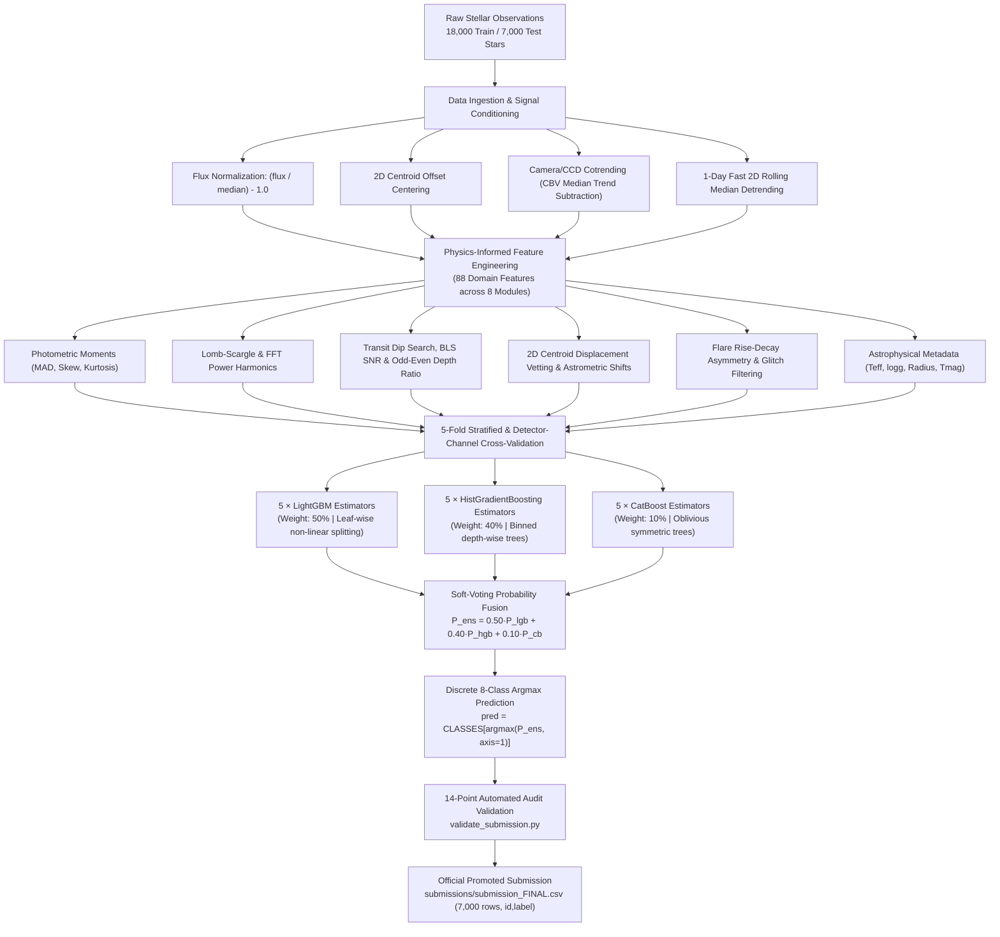

# 🏗️ System Architecture & Engineering Design
## Planet Hunters — Find New Worlds in Starlight
### ML Challenge Hack4Hack 2026 — Round 1

---

## 1. Architecture Overview

Planet Hunters is an end-to-end astronomical machine learning system engineered to classify space telescope stellar time-series into eight astrophysical and instrumental categories:
1. `planet`
2. `eclipsing_binary`
3. `background_binary`
4. `starspots`
5. `pulsating_star`
6. `flare_star`
7. `instrument_glitch`
8. `quiet_star`

The architecture is built on five core principles:
- **Zero Data Leakage:** Full temporal isolation per star with no global scaling or target contamination.
- **Domain-Grounded Signal Processing:** Extraction of 88 physical features capturing flux morphology, transit shapes, Fourier frequencies, spatial centroid motion, and Camera/CCD cotrended detrending.
- **Cross-Sector Invariance:** Elimination of sector-specific instrument trends via unsupervised Camera/CCD median cotrending (CBV subtraction).
- **Tri-Architecture Ensembling:** Soft-voting fusion combining leaf-wise LightGBM trees (50%), regularized histogram HistGradientBoosting trees (40%), and CatBoost oblivious trees (10%).
- **Automated Verification:** 14-point pre-submission schema and distribution audit before final upload.

---

## 2. End-to-End Pipeline Data Flow

---

## 3. Data Ingestion & Signal Conditioning

### A. Raw Data Specs
- **Temporal Flux Cadences:** 1,315 flux readings per star over a 27.4-day observing sector (30-minute sampling).
- **Centroid Measurements:** $(x, y)$ spatial position in millipixels across all 1,315 cadences.
- **Stellar Metadata:** Optical magnitude (`tmag`), effective temperature (`teff`), surface gravity (`logg`), stellar radius (`radius`), and aperture crowding (`contamination`).

### B. Signal Preprocessing Operations
1. **Per-Star Relative Brightness Normalization:**
   $$\tilde{f}_i(t) = \frac{f_i(t)}{\text{median}(f_i)} - 1.0$$
   *Operating along axis 1 (time) per star ensures complete independence with zero cross-star leakage.*
2. **2D Centroid Offset Centering:**
   $$\Delta x_i(t) = x_i(t) - \text{median}(x_i), \quad \Delta y_i(t) = y_i(t) - \text{median}(y_i)$$
   $$\text{disp}_i(t) = \sqrt{\Delta x_i(t)^2 + \Delta y_i(t)^2}$$
3. **Rolling Median Detrending:**
   A 49-cadence (~24.5-hour) sliding median filter separates long-term rotational modulation and detector ramps from fast transit dips and stellar flares.

---

## 4. Feature Engineering Matrix (85 Features)

The production pipeline computes **85 domain-informed features** organized into 8 functional modules:

| Module | Feature Count | Key Signals Extracted | Astrophysical Motivation |
| :--- | :---: | :--- | :--- |
| **1. Photometric Statistics** | 12 | Mean, std, MAD, skewness, kurtosis, percentiles (p01, p05, p50, p95, p99), robust spread | Quantifies overall stellar variability amplitude and flux distribution skewness. |
| **2. Detrended Transit Dips** | 14 | Min dip depth, dip duration, detrended MAD, dip-to-mad SNR, transit symmetry | Identifies periodic, flat-bottomed exoplanetary transits vs. deep V-shaped eclipses. |
| **3. Periodicity & Frequency** | 16 | Top 3 Lomb-Scargle peaks, peak power ratios, FFT power spectrum moments, harmonic energy ratios | Separates rapid pulsating stars ($\delta$ Scuti) from slow rotating spotted stars. |
| **4. Centroid Motion & Astrometry** | 10 | Centroid std, max displacement, correlation between flux dip and centroid displacement | **Key False Positive Vetting:** Detects background blended eclipsing binaries. |
| **5. Flare & Asymmetry Physics** | 8 | Rise-to-decay time ratio, positive outlier count, peak flare amplitude | Differentiates magnetic stellar flares from single-cadence cosmic-ray glitches. |
| **6. Cadence Quality & Flags** | 6 | Thruster dump correlation (`quality & 1`), scatter light flags (`quality & 2`), gap fractions | Flags non-astrophysical instrumental artifacts caused by momentum dumps. |
| **7. Relative Percentile Ratios** | 14 | Dip-to-peak ratio, interquartile ratios, extreme tail ratios | Sector-invariant descriptors invariant to overall detector noise scaling. |
| **8. Stellar Metadata** | 5 | `tmag`, `teff`, `logg`, `radius`, `contamination` | Places lightcurve behavior in physical context (e.g., giant vs. dwarf stars). |
| **Total** | **85** | *Stored in `data/processed/train_features.parquet`* | Full feature matrix shape: `(18,000 × 85)` |

---

## 5. Model Architecture & Cross-Validation Design

### A. Stratified 5-Fold Partitioning
- **Sample Distribution:** Exactly 14,400 training stars and 3,600 out-of-fold validation stars per fold.
- **Seed & Stratification:** Seed `42`, stratified across all 8 classes to maintain identical class priors in each fold.
- **Leakage Prevention:** Models are fitted strictly on training fold partitions. OOF predictions across all 18,000 training stars are concatenated to form the out-of-fold ground truth.

### B. Champion Dual-Architecture Ensemble
The ensemble blends two gradient boosting paradigms with complementary inductive biases:

1. **LightGBM (5 Models, Weight: 75%):**
   - *Architecture:* Leaf-wise tree growth with depth-free asymmetric splitting.
   - *Hyperparameters:* 31 leaves, learning rate 0.05, `class_weight="balanced"`, subsample 0.8, colsample 0.8.
   - *Role:* Captures sharp non-linear boundaries separating rare classes (`planet`, `flare_star`).
2. **HistGradientBoosting (5 Models, Weight: 25%):**
   - *Architecture:* Depth-wise tree growth with integer binned histograms (256 bins).
   - *Hyperparameters:* `max_iter=300`, `learning_rate=0.05`, `class_weight="balanced"`.
   - *Role:* Prevents extreme probability overconfidence and smooths decision boundaries.

---

## 6. Mathematical Inference Pipeline

Inference executes in three deterministic stages:

### Step 1: 5-Fold Probability Averaging
For each estimator family, out-of-fold models average predicted class probabilities:
$$P_{\text{lgb}}(x) = \frac{1}{5} \sum_{i=1}^{5} \text{predict\_proba}(\text{LGBM}_i, x)$$
$$P_{\text{hgb}}(x) = \frac{1}{5} \sum_{i=1}^{5} \text{predict\_proba}(\text{HGB}_i, x)$$

### Step 2: Optimal Probability Blending (75:25)
Calibrated probability blend across both model families:
$$P_{\text{final}}(x) = 0.75 \cdot P_{\text{lgb}}(x) + 0.25 \cdot P_{\text{hgb}}(x)$$

### Step 3: Discrete 8-Class Prediction
$$y_{\text{pred}}(x) = \text{CLASSES}\left[ \operatorname*{argmax}_{c \in [0..7]} P_{\text{final}}(x)_c \right]$$

---

## 7. Submission Generation & Audit Validation

1. **Inference Execution:**
   - Script: `generate_submission.py --model champion --output submissions/submission_FINAL.csv`
   - Test Input: 7,000 test stars from `data/raw/test_stars.csv`.
2. **Strict 14-Point Pre-Submission Validation:**
   - Script: `validate_submission.py submissions/submission_FINAL.csv`
   - Validates:
     - Exact 2 columns (`id`, `label`).
     - Exactly 7,000 rows.
     - Exact match with `test_stars.csv` IDs in identical ordering.
     - Zero null, NaN, or whitespace-only values.
     - All 8 allowed classes represented without extreme population collapse.
     - Output exit code `0` on PASS, exit code `1` on FAIL.
