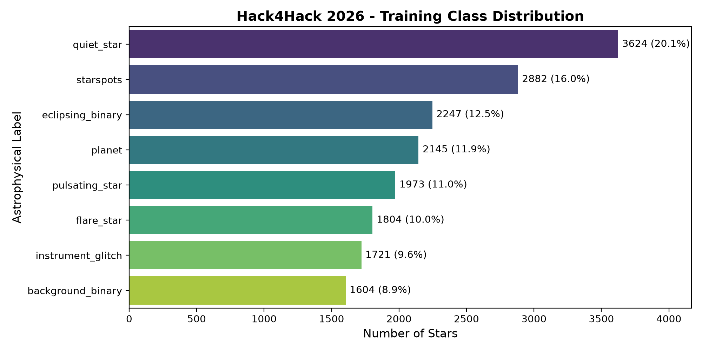

# Dataset Inspection Report: Planet Hunters (Hack4Hack 2026)

## 1. Overview and Dimensionality
- **Competition**: ML Challenge Hack4Hack 2026 - Round 1
- **Evaluation Metric**: Macro F1-score across 8 astrophysical classes
- **Cadences per Star**: 1,315 observations (spanning ~27.4 days with ~30-min sampling)

### Dataset Shapes & Memory
| Dataset | Object / File | Dimensions | Data Type | Missing Count (%) |
|---|---|---|---|---|
| Train | `train_flux.npy` | (18000, 1315) | float32 | 954,000 (4.03%) |
| Train | `train_centroid.npy` | (18000, 2, 1315) | float16 | 1,908,000 (4.03%) |
| Train | `train_stars.csv` | (18000, 9) | CSV | See metadata section |
| Train | `train_cadences.csv` | (1315, 3) | CSV | 0 missing |
| Test | `test_flux.npy` | (7000, 1315) | float32 | 371,000 (4.03%) |
| Test | `test_centroid.npy` | (7000, 2, 1315) | float16 | 742,000 (4.03%) |
| Test | `test_stars.csv` | (7000, 8) | CSV | See metadata section |
| Test | `test_cadences.csv` | (1315, 3) | CSV | 0 missing |
| Sub | `sample_submission.csv` | (7000, 2) | CSV | Exactly 7,000 rows |

## 2. Target Class Distribution
Evaluation is strictly **Macro F1-score**, giving equal importance to every class regardless of prevalence.

| Class | Count | Percentage | Class Weight (balanced) |
|---|---|---|---|
| `quiet_star` | 3,624.0 | 20.13% | 0.621 |
| `starspots` | 2,882.0 | 16.01% | 0.781 |
| `eclipsing_binary` | 2,247.0 | 12.48% | 1.001 |
| `planet` | 2,145.0 | 11.92% | 1.049 |
| `pulsating_star` | 1,973.0 | 10.96% | 1.140 |
| `flare_star` | 1,804.0 | 10.02% | 1.247 |
| `instrument_glitch` | 1,721.0 | 9.56% | 1.307 |
| `background_binary` | 1,604.0 | 8.91% | 1.403 |



## 3. Metadata Profiles & Missing Values
### Train Metadata Nulls:
```
None
```

### Test Metadata Nulls:
```
None
```

### Metadata Statistical Summary (Train):
|       |        tmag |     teff |         logg |      radius |   contamination |      camera |         ccd |
|:------|------------:|---------:|-------------:|------------:|----------------:|------------:|------------:|
| count | 18000       | 18000    | 18000        | 18000       |    18000        | 18000       | 18000       |
| mean  |    12.3528  |  5139.78 |     4.26958  |     1.54461 |        0.182735 |     2.48678 |     2.49928 |
| std   |     1.89528 |  1526.79 |     0.578973 |     1.83154 |        0.135579 |     1.11918 |     1.11433 |
| min   |     7.53    |  2800    |     2.4      |     0.18    |        0        |     1       |     1       |
| 25%   |    10.9425  |  3880    |     4.11     |     0.4     |        0.076    |     1       |     2       |
| 50%   |    12.555   |  4920    |     4.37     |     1.08    |        0.153    |     2       |     3       |
| 75%   |    13.927   |  6190    |     4.61     |     1.46    |        0.262    |     3       |     3       |
| max   |    15.499   |  8600    |     5.1      |    11.93    |        0.84     |     4       |     4       |

### Metadata Statistical Summary (Test):
|       |       tmag |    teff |        logg |     radius |   contamination |     camera |        ccd |
|:------|-----------:|--------:|------------:|-----------:|----------------:|-----------:|-----------:|
| count | 7000       | 7000    | 7000        | 7000       |     7000        | 7000       | 7000       |
| mean  |   12.3496  | 5146.46 |    4.26747  |    1.54867 |        0.184573 |    2.47429 |    2.502   |
| std   |    1.89003 | 1530.93 |    0.581459 |    1.82629 |        0.138434 |    1.11411 |    1.12372 |
| min   |    7.565   | 2800    |    2.4      |    0.18    |        0        |    1       |    1       |
| 25%   |   10.938   | 3860    |    4.1      |    0.3875  |        0.077    |    1       |    1       |
| 50%   |   12.565   | 4920    |    4.37     |    1.08    |        0.153    |    2       |    3       |
| 75%   |   13.896   | 6210    |    4.62     |    1.48    |        0.263    |    3       |    4       |
| max   |   15.494   | 8600    |    5.1      |   11.51    |        0.9      |    4       |    4       |

## 4. Cross-Sector & Cadence Quality Comparison
Training and test sets originate from different sectors, leading to differing instrumental trends:
- **Train Sector Cadences**: 1315 observations, time range 2104.27 to 2131.65 BTJD
  - Momentum Dumps (`quality & 1`): 8 (0.6%)
  - Scattered Light (`quality & 2`): 66 (5.0%)
  - Data Gaps (`quality & 4`): 212 (16.1%)
- **Test Sector Cadences**: 1315 observations, time range 2131.88 to 2159.25 BTJD
  - Momentum Dumps (`quality & 1`): 10 (0.8%)
  - Scattered Light (`quality & 2`): 66 (5.0%)
  - Data Gaps (`quality & 4`): 212 (16.1%)

## 5. Alignment and Integrity Verification
1. **Row Index Alignment**: Confirmed that row `i` in `train_stars.csv` maps 1:1 to row `i` in `train_flux.npy` and `train_centroid.npy`.
2. **Test ID Alignment**: Confirmed that row `i` in `test_stars.csv` exactly matches row `i` of `sample_submission.csv` and the test arrays.
3. **No Duplicate IDs**: All 18,000 train IDs and 7,000 test IDs are unique.
4. **NaN Safety**: NaNs occur primarily during mid-sector data downlinks (~cadence 600-700) and flagged bad cadences. Missing values must be filtered with nan-safe statistical operators (`np.nanmedian`, `np.nanstd`, etc.).
